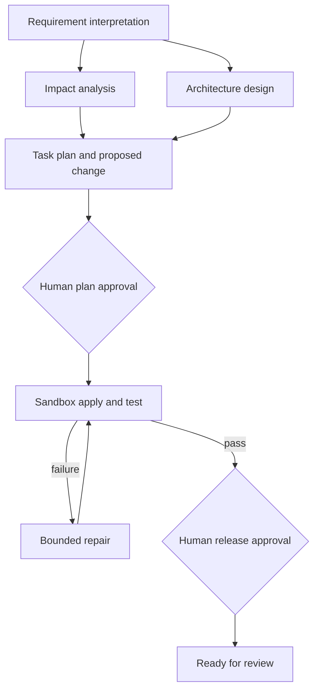

# Agentic URL Shortener (Java 17)

This repository contains two small, dependency-free Java 17 prototypes:

1. An HTTP URL shortener with custom aliases, redirects, and click-count analytics.
2. An approval-gated SDLC workflow that asks an OpenAI-compatible model to interpret a requirement, analyze a repository, design and propose changes, then validate those changes in a disposable sandbox.

The workflow never edits the supplied repository and never deploys. It creates a reviewable proposal and an isolated working copy only after explicit plan approval. A second approval marks a validated result `READY_FOR_REVIEW`; it does not publish or promote anything.

## Requirements and verification

- Java 17 or later JDK
- Git for unified diff generation
- Optional: an OpenAI-compatible chat-completions endpoint for workflow planning
- Optional: Maven or Gradle in a target repository so the workflow can run its tests

Run the dependency-free compile and regression checks:

```bash
bash scripts/test.sh
```

Build the application and start the URL service on port 8080:

```bash
bash scripts/run.sh serve 8080
```

If Maven is available, `mvn test` compiles the project. The project’s integration-style smoke tests are in `SelfTest` and are run by `scripts/test.sh` and CI.

## URL API

Create a short URL:

```bash
curl -i http://localhost:8080/api/shorten \
  -H 'Content-Type: application/json' \
  -d '{"url":"https://example.com/articles/agentic-sdlc","alias":"demo1"}'
```

`alias` is optional. If omitted, the service generates a random Base62 code. Aliases must be 3–32 letters, digits, `_`, or `-`.

```bash
curl -i http://localhost:8080/demo1
curl http://localhost:8080/api/analytics/demo1
curl http://localhost:8080/health
```

The in-memory store is intentionally for demonstration: links are lost when the process restarts. This is not a production deployment.

## Agent backend setup

The workflow calls an OpenAI-compatible `POST /chat/completions` endpoint. Configure the provider without putting keys in source control:

```bash
export AGENTIC_LLM_API_KEY='your-key'
export AGENTIC_LLM_MODEL='your-model'
# Optional; defaults to https://api.openai.com/v1
export AGENTIC_LLM_BASE_URL='https://api.openai.com/v1'
```

Repository excerpts are sent to the configured model. Use only repositories and providers you are authorized to share. If provider settings are missing or a stage fails, the workflow safe-stops with `MANUAL_REVIEW_REQUIRED`; it does not fabricate success or apply a fallback template.

## Governed workflow

Run planning first. Planning reads the supplied repository and writes artifacts under `~/.agentic-url-shortener/runs/<run-id>`; it does not change the repository.

```bash
bash scripts/run.sh workflow plan \
  --repo /path/to/repository \
  --requirement 'Add a configurable expiration time to shortened URLs' \
  --scenario brownfield
```

Review `proposal.md`, the stage JSON files, and `audit.jsonl`. Then explicitly approve the plan:

```bash
bash scripts/run.sh workflow apply --run <run-id> --approve-plan
```

The workflow copies the repo into a run-specific sandbox, applies proposed changes there, detects and runs a supported test command, and permits at most two repair attempts. A successful validation pauses for a second review gate. Review `diff.patch`, validation logs, and `final-engineering-summary.md`, then approve the outcome:

```bash
bash scripts/run.sh workflow finalize --run <run-id> --approve-release
```

This marks the sandbox result `READY_FOR_REVIEW`. It does not create a Git commit, push to GitHub, deploy, or promote a release. Rejecting a run removes its sandbox and records a source fingerprint check:

```bash
bash scripts/run.sh workflow reject --run <run-id> --reason 'Risk is too high'
```

To replan after changing a requirement, create a new plan and reference the old run. The old run and audit remain, while its approvals are invalidated:

```bash
bash scripts/run.sh workflow plan --repo /path/to/repository \
  --requirement 'Updated requirement...' --supersedes <old-run-id>
```

View measured execution metrics:

```bash
bash scripts/run.sh workflow metrics
```

## Architecture



The workflow runs repository impact analysis and architecture design in parallel after requirement interpretation. Their outputs feed task planning and implementation. Each stage stores its input hash, output artifact reference, and completion event. Validation runs produce exit codes, durations, command names, and bounded output logs. Metrics are calculated from persisted run records, not hard-coded demo values.

## Safety boundaries and trade-offs

- **Read-only source boundary:** repository inspection and planning are read-only. Approved changes are applied only to a copy under the run artifact directory. A fingerprint check blocks stale plans and verifies the source stayed unchanged.
- **Human control:** plan approval is required before sandbox application; release approval is required after validation. A changed source fingerprint invalidates old approvals.
- **Path policy:** rejects absolute paths, traversal, symlinks, secrets/key files, Git metadata, and workflow credential files. Changes have file-count and size limits.
- **Failure handling:** missing/failed model calls stop for manual review. Tests are bounded by a timeout. Failed validation enters a repair loop with a maximum of two repairs, then removes the sandbox and records rollback evidence.
- **Ambiguity:** the `ambiguous` scenario pauses for clarification rather than guessing.
- **No production autonomy:** this prototype does not commit, push, deploy, or promote. It is not a hardened OS-level sandbox: build scripts from the reviewed repository run as the current user with a reduced environment. Use a disposable container/VM before running untrusted repositories.
- **Service storage:** URL records and analytics are in-memory; persistence, distributed uniqueness, rate limiting, auth, and production analytics are out of scope.

## Scenario walkthroughs

See [`docs/scenarios/`](docs/scenarios/) for greenfield, brownfield, and ambiguous-input run recipes. A real provider-backed run is required to create live evidence. The checked-in examples describe the expected artifact trail; they do not claim that those runs have already executed.

## Assessment checklist mapping

| Review item | Implementation evidence |
|---|---|
| 1. Actual engineering changes | LLM returns file contents/deletions; explicit apply creates a sandbox diff |
| 2. Context-sensitive reasoning | Configurable model provider receives each requirement, repository evidence, and previous-stage outputs |
| 3. Brownfield reasoning | Bounded repository inventory, file excerpts, Git status, impact stage |
| 4. Validation gates | Supported build command, exit code, output, duration; no pass without execution |
| 5. Failure-driven repair | Failed output feeds a repair stage; at most two repair attempts |
| 6. Rollback | Sandbox cleanup plus before/after source fingerprint evidence |
| 7. Greenfield | Run on an empty starter directory; generated files appear only in sandbox |
| 8. Brownfield | Run on a known repository; source stays unchanged while sandbox contains the patch |
| 9. Decision lineage | Per-stage input hash, output artifact, audit event, validation/repair record |
| 10. Effective approvals | Explicit plan-approval and release-approval CLI gates |
| 11. Dynamic replanning | New run with `--supersedes`; old approval is invalidated and prior evidence retained |
| 12. Meaningful fallback | Provider failure stops for manual review; no unvalidated result becomes success |
| 13. Final documentation | Provider generates a summary from final changed source and actual test evidence |
| 14. Three scenarios | Scenario recipes cover greenfield, brownfield, and clarification stop |
| 15. Execution-derived metrics | `workflow metrics` reads persisted runs and measured validation/repair/rollback events |

Some checklist items require a live, reviewer-observable provider run (especially contextual code generation and scenario evidence). The docs distinguish runnable behavior from expected outcomes; do not present sample recipes as completed executions.
